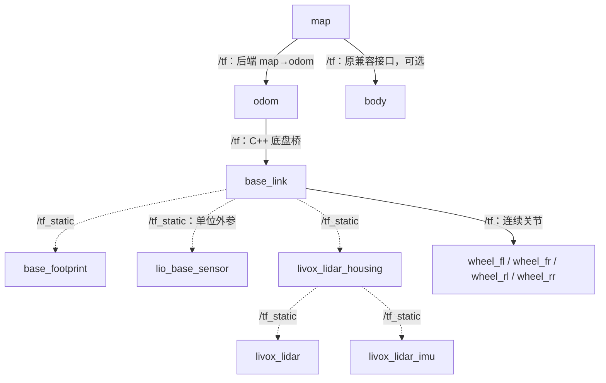
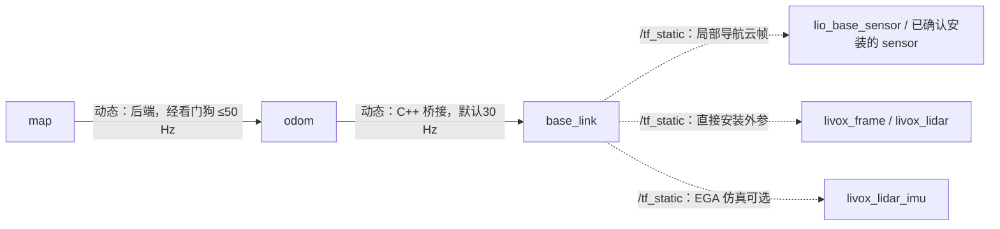

# TF 树审计与导航瘦身（2026-11-16）

核验范围：远程 `xxu_2027` 对应本地仓库，实际 ROS 源码为 `xxu_nav_2026/src`（含 `src/z-localization`）。接手时已有 C++ 接入和文档改动，本任务在其基础上定点修改。根目录 `z-localization/src` 是 Git 忽略的旧独立副本：纳入搜索和差异盘点，不另行维护第二套业务源码；其 `deps` 仅复用已有依赖。该旧副本的前端仍默认开启 TF，不能作为本次导航入口。来源关系沿用 [迁移记录](zlocalization_src_migration_20261031.md) 与 [C++ 接入核验](zlocalization_cpp_integration_20261116.md)。

以下“修改前”是接手时源码和启动配置的拓扑，互斥入口分别列出；不是未经采样的运行树。域 1 旧前端进程仍运行旧二进制，本次未重启它。

## 修改前拓扑

### 固定 EGA 仿真导航

实线标注 `/tf`，虚线标注 `/tf_static`。专用动态流先到看门狗，再转发全局 `/tf`。后端兼容分支是否出现还取决于选择的配置，基础 YAML 原设置 `output.legacy.publish_tf=true`。



发布者为桥接、后端、`robot_state_publisher`；后者 `publish_frequency=100.0` 是动态关节发布上限，不能将其当作现场实测频率。固定关节原本就由 RSP 走 `/tf_static`，未发现其固定外参使用定时器伪装成动态 TF。

### 刚性实车入口


外参来自经过确认的安装 YAML，不使用仿真尺寸代填。`base → sensor → lidar` 的两级静态链可合成为直接子帧；传入的去畸变云已在 `sensor` 下，扫描转换原本只需 `sensor → base_link` 一次静态变换。

### 其他入口及完整机械分支

| 入口 | 修改前 TF 边与话题 | 审计结论 |
| --- | --- | --- |
| 上游 `rm_sim_26` 仿真模型（由自建 launch 适配） | `base_link → chassis` 静态；`base_link → wheel_{fl,rl,rr,fr}_link` 动态；`base_link → gimbal_link` 动态；`gimbal_link → livox_lidar` 静态；`gimbal_link → small_yaw_link → pitch_link` 动态；`pitch_link → gimbal_imu / camera_mount` 静态；另有 `base_link → lio_base_sensor` 静态 | 上游机械分支无需进入导航 TF。原 launch 还生成 **`base_footprint → base_link`**，可与桥接的 `odom → base_link` 形成双父关系；已移除生成逻辑 |
| `xxu_description` 两个 Xacro | `base_link → gimbal_link` 动态；`gimbal_link → mid360_link` 静态；实车模型另有 `mid360_link → livox_frame` 静态；`base_link → lio_base_sensor / base_footprint` 静态；四轮在展示模型为固定关节、Gazebo 模型为连续关节 | 物理关节保留在模型；删除地面投影帧。独立展示的 RSP/JSP/RViz 使用私有 TF 和关节话题 |
| `z-localization` 前端 | 默认 `odom` 与 `imu`；实际导航 launch 已设 `publish_tf=false`；原代码仍允许开启后按 IMU 预测频率广播 | 当前移除前端 broadcaster；`publish_tf=true` 明确报错，要求使用底盘桥 |
| 后端主输出 | `map → odom`；旧 `legacy` 输入的未覆盖默认父系名称为 `camera_init` | 导航仍使用 `odom`。`camera_init` 是兼容模式默认名称，不是当前导航树的额外中间节点 |
| 后端兼容输出 | `map → body`，可按自定义 body 名称变化 | ZLIO 输入始终禁止该额外 TF；保留兼容位姿、速度话题。主 YAML 开关关闭；非 ZLIO legacy 输入的可选兼容行为仍保留 |
| 第三方 TurtleBot3 多机器人示例 | 各 namespace 的 RSP、Nav2/SLAM；示例配置使用 `base_footprint` | 未被 XXU 导航入口包含，保留第三方示例，不将其画入 XXU 运行树 |
| 标定、独立反向扫描转换、离线诊断 | TF 消费者，不新增上述导航边 | 见订阅清单；不作为高频导航链启动 |

未发现 `odom_imu` 发布者，也未在已选 XXU 导航入口发现单独装甲板 TF 发布者。机械几何的 link、Gazebo PosePublisher 输出的 `/ground_truth` 均不自动等同于 ROS 全局 TF。

## 当前核心拓扑与职责



核心是 `map → odom → base_link → 传感器`；传感器是底盘的直接静态子帧，不再经过壳体、地面投影或机械关节。`lio_base_sensor` 保留输入已补偿到的局部坐标语义，不能仅改标签冒充原始雷达坐标。上游可动云台只发布固定的补偿后虚拟帧；实际移动的原始传感器不伪装成静态外参。

- [传感器启动构造](../../xxu_nav_2026/src/xxu_bringup/xxu_bringup/sensor_launch.py)：刚性安装计算 `T_base_lidar = T_base_sensor × T_sensor_lidar`，两个传感器直接接 `base_link`；URDF 提取器只合成固定链，遇移动关节、断链或循环即拒绝。所有安装外参由 `tf2_ros/static_transform_publisher` 走 `/tf_static`，无周期性固定 `/tf`。
- [仿真启动](../../xxu_nav_2026/src/xxu_sim_bringup/launch/rm_sim_gazebo.launch.py)：移除 RSP，EGA 只启三个直接静态传感器发布者；上游云台只启虚拟补偿帧。车轮、云台、壳体仍在物理模型中，但没有对应导航广播进程。模型生成器与两个 Xacro、EGA URDF 均不再生成 `base_footprint`。
- [接口契约](../../xxu_nav_2026/src/xxu_bringup/config/robot_interfaces.yaml)：`ground_base` 作为旧调用兼容键指向 `base_link`，没有同名新增 TF；动态契约只列两条核心边。Nav2 实际文件是 `nav2_navigation.yaml`、`nav2_exploration.yaml`，相关机器人基帧已为 `base_link`；SLAM 配置此次同步改为 `base_link`。示例扫描启动也改为 `base_link`。
- [底盘桥](../../xxu_nav_2026/src/xxu_bringup/src/zlio_base_odometry.cpp)：保留 `T_odom_base = T_odom_sensor × inverse(T_base_sensor)`、原始采样时间和 `child_frame_id=base_link`。`/odom` 不随 TF 降采样；相同输入时间戳不续期。`tf_publish_rate` 默认 30 Hz，仅允许 20–50 Hz，用独立墙钟 Timer 取最新的新位姿；无新数据则不广播。
- [看门狗](../../xxu_nav_2026/src/xxu_bringup/src/cmd_vel_watchdog.cpp)：专用输入只剩 `/sentry/tf/odometry` 与 `/sentry/tf/localization`，不再订阅 `/sentry/tf/robot`。只转发 `map → odom` 和 `odom → base_link`，全局出口每条边默认最多 50 Hz（参数限 20–50 Hz）；不由 100 Hz 速度输出 Timer 重发 TF。动态边、指令和定位新鲜度保护保留，所需 TF 不再包含机械云台边；关节反馈保护按入口原有开关保留。
- [独立展示](../../xxu_nav_2026/src/xxu_description/launch/display.launch.py)：仅用于查看机械模型，RSP、JSP 与其 RViz 使用 `/model_display/tf`、`/model_display/tf_static`、`/model_display/joint_states`，不把模型分支广播到导航的全局话题。

TF 频率不能高于真实数据供给；输入不足 20 Hz 或系统过载时不凭空补帧。20–50 Hz 是配置约束和本次正常供给探针范围，不是对所有现场调度状态的频率保证。

## 全部发布与订阅盘点

[源码命中清单](../../xxu_nav_2026/log/tf_audit_20261116/tf_source_inventory.txt) 包含两个源码目录、launch、包依赖与相关 ROS 头文件；[工具清单](../../xxu_nav_2026/log/tf_audit_20261116/tf_tool_inventory.txt) 单独记录诊断/测试 Python。清单是定位入口，不把注释或依赖声明当作运行节点。

| 模块 / 路径 | TF 发布 / 消费 | 当前部署边界 |
| --- | --- | --- |
| `xxu_bringup/src/zlio_base_odometry.cpp` | 发布底盘动态 TF；按参数或只订阅 `/tf_static` 取得静态外参，成功后释放订阅和 Buffer | 高频桥无全局 TF Listener |
| `xxu_bringup/src/cmd_vel_watchdog.cpp` | 消费两条私有动态流与 `/tf_static`，维护 Buffer；发布核心全局动态边 | 不订阅全局 `/tf`，保留静态订阅以发现新发布者和父节点冲突 |
| `xxu_bringup/src/pointcloud_frame_republisher.cpp` | 固定模式仅启动期消费 `/tf_static` 并缓存；云台模式只消费关节并解析补偿 | 不消费全局 `/tf`，不发布 TF |
| `pointcloud_to_laserscan/src/pointcloud_to_laserscan_node.cpp` | 只接收 `/tf_static`；首次成功缓存静态转换并释放订阅/Buffer | 导航扫描使用此组件；未使用动态 MessageFilter |
| `z-localization/src/backend/apps/publisher*.cpp` | 发布 `map → odom`；非 ZLIO legacy 模式另可选 map→body | ZLIO 模式兼容 TF 被抑制；无 TF 订阅 |
| `z-localization/src/frontend/apps/node.cpp` | 当前无 TF broadcaster / subscriber | 只发里程计、原子帧和局部去畸变云 |
| `xxu_bringup/xxu_bringup/sensor_launch.py` | 构造 `static_transform_publisher`，不处理高频 ROS 消息 | Launch Python 只计算启动外参 |
| `xxu_description/launch/display.launch.py` | RSP/JSP 构造机械模型 TF | 私有话题；不用于导航外参 |
| `pointcloud_to_laserscan/src/laserscan_to_pointcloud_node.cpp` | 可选反向转换仍有 TransformListener | 当前导航没有启动该通用反向组件 |
| `z-localization/src/backend/tools/calibrate.cpp` | 持续读 `map ← odom` 的标定观察器 | 离线/专门标定入口，不在高频主链 |
| `m-explore-ros2/explore` | 独立探索节点的 TransformListener、机器人地图位置查询 | 自主建图入口使用；没有将第三方低频地图规划消费者误删 |
| Nav2、SLAM Toolbox、RViz（安装依赖） | 根据其功能消费 TF；SLAM 模式可拥有 map→odom | 这些是必要的规划/显示消费者；不得与 ZLIO 后端同时拥有同一动态边。没有声称整个 ROS 生态零 TF 订阅 |
| 根目录 `z-localization/src` | 旧前端 broadcaster、后端 map→odom / legacy map→body、标定 Listener | 未被本次导航源码和安装选择；禁止将此旧副本与新导航同时启动 |
| 第三方 `map_merge/launch/tb3_simulation` | RSP 与独立 TurtleBot3 导航/SLAM 启动 | 保留示例，不被 XXU 主线引入 |
| `tools/navigation`、`tools/lio` | 可选采样、录制、检查工具和合成 ROS 测试会消费 `/tf` | 非部署的高频传感器/控制节点；本次临时探针在结束后退出 |

## 点云与扫描 Frame ID

[前端](../../xxu_nav_2026/src/z-localization/src/frontend/apps/node.cpp) 的原子去畸变云坐标为 `frames_.body`（默认 `imu`），不是世界系。独立 `/cloud_deskewed` 保留同一几何，仅在已经预处理到同一固定坐标系的组合入口中设置 `deskewed_cloud_frame=lio_base_sensor`（实车使用安装文件的 `frames.sensor`）。该别名不发布新的 `odom → imu`。

`/frontend/cloud_registered` 是可视化节点变换到 `odom` 的世界系显示云，不作为扫描输入。RMUL 和实车组合的扫描均为：

```text
/cloud_deskewed [局部 sensor] --一次已缓存的静态 T_base_sensor--> /scan [base_link]
```

因此主链没有动态 TF 时间戳插值，也不需要通过 `map`、`odom`、壳体或 `base_footprint` 绕行。当前扫描器只支持静态坐标转换，若错误地把世界系显示云接入，它会因静态路径缺失而不发扫描；不能把这种缺配置当作丢帧修复。源帧改变时拒绝复用旧缓存，不能通过只改 `header.frame_id` 抹平实际坐标差异。

## 复现、当前验证与证据

日期为 2026-11-16；测试使用隔离 ROS 域，无硬件、无用户导航目标。已有库复用系统 Eigen；未安装依赖、提交、推送或发布。

| 核验对象 | 当前结果 | 证据 |
| --- | --- | --- |
| 限频原始问题 | 旧安装版：31 Hz 输入仅 15.498 Hz TF，200 Hz 输入 28.995 Hz TF；31 Hz 用例失败，确认回调时间门控的分频原因 | [原始失败](../../xxu_nav_2026/log/tf_audit_20261116/baseline_rate.log) |
| 五个受影响包 Release 构建 | `xxu_description`、`backend`、`frontend`、`xxu_bringup`、`xxu_sim_bringup` 完成；后续展示/示例 launch 为 Python 数据文件的定点修改，另做语法与展开检查 | [构建日志](../../xxu_nav_2026/log/tf_audit_20261116/build.log) |
| 已安装 C++ 集成测试 | 11/11 通过；31 / 200 Hz 输入分别约 29.994 / 29.998 Hz 底盘 TF，冻结时间戳/停流不重播；全局转发每条核心边约 49.986 Hz，机械边不转发 | [集成结果](../../xxu_nav_2026/log/tf_audit_20261116/cpp_pipeline.log) |
| 合成 IMU/点云/扫描吞吐 | 3 秒 600/30/30，200/10/10 Hz；仅适配器/扫描，不包含估计器或实车 | 同上 |
| 前后端、组合/重置、桥接相关 CTest | 9 个目标、41 个用例通过；覆盖前端消息/生命周期/两种输入/可视化、后端 TF 水位与配置、组合/重置、C++ 外参和保护 | [逐项结果](../../xxu_nav_2026/log/tf_audit_20261116/test_results.json)、[首轮回归](../../xxu_nav_2026/log/tf_audit_20261116/regression.log)、[组合复测](../../xxu_nav_2026/log/tf_audit_20261116/bringup_regression_final.log) |
| 静态安装与几何 | MountTest 8 项通过，新增非交换旋转/平移合成和移动关节拒绝；原有测试还委托 C++ 回归。两个 Xacro 仍单根 base_link；EGA 三个直接静态外参成功生成 | [安装/启动检查](../../xxu_nav_2026/log/tf_audit_20261116/interface_and_launch_tests.log)、[模型结果](../../xxu_nav_2026/log/tf_audit_20261116/model_topology.json) |
| 车辆参数、导航启动 | 车辆参数最终 15/15，导航启动 2/2；接口契约检查通过 | [车辆参数复测](../../xxu_nav_2026/log/tf_audit_20261116/vehicle_parameters_final.log)、上述安装/启动日志 |
| 审计时旧会话只读采样 | 域 1 有旧前端；5.02 秒未收到动态/静态 TF，发现 `/tf` 发布者 zlio；没有据此推断新代码已在旧会话生效 | [采样](../../xxu_nav_2026/log/tf_audit_20261116/live_domain1.json) |
| 拓扑交互图 | architecture；9/9 showcase 检查、0 错误/警告；1440×900、1600×1000、1920×1080、2048×1320 浏览器包含检查通过；已检查 1440×900 明色及 2048×1320 明暗截图，文字、边与卡片未见遮挡 | [图](../../xxu_nav_2026/log/tf_audit_20261116/tf_core.html)、[交付回执](../../xxu_nav_2026/log/tf_audit_20261116/diagram_delivery.json)、[浏览器证据](../../xxu_nav_2026/log/tf_audit_20261116/tf_core.visual-check.json) |

首轮启动展开回归有一项失败，因为旧测试用空 `<robot/>` 替代 URDF；新外参提取器正确拒绝缺失链。将夹具改为含真实结构的最小固定传感器链，并增加无 RSP / 直接子帧断言后，15 项通过，没有放宽业务检查。

首轮组合/重置测试另因 shell 中第三方库搜索路径选中旧 libusb，使 PCL 报 `undefined symbol: libusb_set_option`、后端退出 127。保留[失败日志](../../xxu_nav_2026/log/tf_audit_20261116/initial_bringup_environment_failure.log)，仅测试进程先清除 `LD_LIBRARY_PATH`，加载 Jazzy 与工作区 local_setup，再加入既有 `z-localization/deps/lib` 后复测通过；没有修改全局环境或业务阈值。

图的规格 SHA-256 为 `bde7c7787bb74a43fdf3743fa7c64fe9ba5288f5660eb3fd21e60dba8f617958`（2722 字节），HTML 为 `18248679c2271934b2d7a21fb423e4aa32b358eac5f02d9f41513a6c2daaa0ab`（704854 字节）；浏览器通过与视觉审查分别记录；本次已实际查看上述三张截图。图和运行日志在忽略的本地 `log` 目录，持久拓扑与结论以本文为准。

本次最终静态检查：11 个修改的 Python 文件语法、4 个 YAML、1 个 package.xml、本文全部直接文件链接通过；`git diff --check` 通过，见 [检查结果](../../xxu_nav_2026/log/tf_audit_20261116/static_final.json)。

## 后续 Gazebo 四目标导航实测（2026-11-16）

按用户“启动导航做测试”执行，使用新隔离域 73、独立 Gazebo 分区，无界面、无实车。沿用 `tested_sim` 对应的地图、`interval_mean` IMU、实验后端和显式停车/航向测试 profile；没有调低内存保护或放宽导航通过标准。实际启动参数保存在[结果](../../xxu_nav_2026/log/navigation_tf_test_20261116/four_goals_retry/result.json)中；[汇总](../../xxu_nav_2026/log/navigation_tf_test_20261116/summary.json)记录本轮数值。

测试脚本的两处 `map ← base_footprint` 查询已与当前核心树对齐为 `map ← base_link`，仅修改[回归观察器](../../xxu_nav_2026/tools/navigation/check_ega_navigation.py)，没有修改业务节点、默认地图或导航参数。使用本次已构建安装的 C++ 节点。

| 连续目标（x, y, yaw） | 动作结果 | 停稳后物理 XY 误差 | 停稳后物理航向误差 | 停车、10 秒定位稳定性、源速度检查 |
| --- | --- | --- | --- | --- |
| `(2, 2, π)` | SUCCEEDED | 0.90 cm | 0.15785 rad | 通过 |
| `(2, 2, 0)` | SUCCEEDED | 0.09 cm | 0.03373 rad | 通过 |
| `(3, 2, 0)` | SUCCEEDED | 2.17 cm | 0.03750 rad | 通过 |
| `(2, 2, 0)` | SUCCEEDED | 5.53 cm | 0.01886 rad | 通过 |

四目标整体 `passed=true`，定位监督未触发失信取消；每目标停车后的定位稳定性和原始/适配里程计静止速度证据均通过。Nav2 目标检查器实际参数为 `StoppedGoalChecker`、XY 0.06 m、yaw 0.2 rad；独立物理落点验收沿用原 0.12 m / 0.2 rad，未放宽。两次原地转向各出现一次 `Failed to make progress`，随后目标成功；不能描述成无告警运行。

[20 秒运行采样](../../xxu_nav_2026/log/navigation_tf_test_20261116/runtime_probe_motion.json)中，`odom → base_link` 为 30.015 Hz，`map → odom` 为 50.000 Hz（均按墙钟接收窗口估计）；只有这两条动态边。三个静态边均为 `base_link` 的直接传感器子帧，分别为 `lio_base_sensor`、`livox_lidar`、`livox_lidar_imu`。去畸变云和扫描各收到 191 帧、均约 10.20 Hz，帧分别为 `lio_base_sensor` 与 `base_link`；同一采样窗口未观察到云转扫描数量损失。原始点云约 9.98 Hz，补偿 IMU 与里程计约 99.8 Hz，仿真实时率约 0.998。这不是长期零丢帧保证，也不是实车频率结果。

首次启动触发既有 3072 MiB 可用内存保护，最低记录 3071 MiB，未发送目标；保留[首次失败](../../xxu_nav_2026/log/navigation_tf_test_20261116/four_goals/result.json)。确认并关闭域 90 中脱离启动器的旧 Gazebo 后重新执行，复测最低可用内存 3146 MiB。没有清理其他应用或调整保护门限。

测试结束按回归脚本停止本轮实例。关闭阶段有一条约 4.5 ms 的未来 TF 外推错误，发生于 Collision Monitor 清理时；启动监督 `nav2_navigation_startup` 未响应正常退出，由 Launch 升级为 SIGKILL。原始信息保存在[启动/退出日志](../../xxu_nav_2026/log/navigation_tf_test_20261116/four_goals_retry/launch.log)，未修复或隐藏这些退出问题。[退出检查](../../xxu_nav_2026/log/navigation_tf_test_20261116/cleanup_check.json)确认测试域及两个测试分区均无剩余进程；导航未保持后台运行。

## 尚未完成的现场验证

已完成上述限定四目标 Gazebo 闭环；长路线、动态避障及更长时间稳定性回归仍未完成。未执行实车外参测量、硬件频率/CPU 压测或 `/scan` 历史丢帧录包复现，不能声称实车丢帧问题或 CPU 降幅已实测解决。域 1 旧进程已按后续清理请求退出，没有重新启动旧会话。

加载同一新安装环境并按用户实际部署安排启动后，应以 `view_frames` 和按边计数的 TF 采样检查只有两个动态核心边、直接静态传感器子帧，核对 `/cloud_deskewed` 与 `/scan` 的帧及源时间。`ros2 topic hz /tf` 统计整条消息流，不能代替 `odom → base_link` 的按边测频。测量真实 IMU、点云、扫描频率，并核验地图与安装配置匹配；不要并行运行旧独立前端、机械模型的全局 TF 或另一个 map→odom 发布者。
