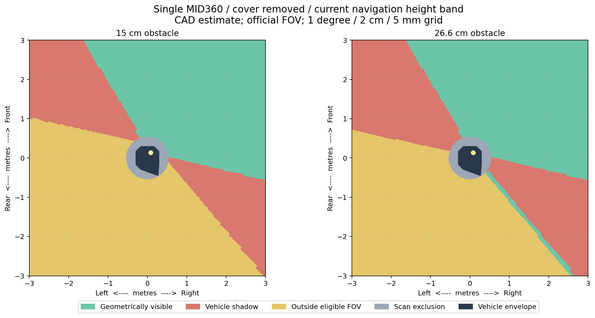

# 单 MID360 折叠车模盲区量化

核验日期：2026-10-19。对象：当前 `ega_folded` 固定折叠构型、仅保留原导航雷达、保护罩取下。本文为本配置盲区分析的正文；完整数值、输入文件 SHA-256 及计算口径见 [results.json](results.json)，离散网格见 [visibility_grid.npz](visibility_grid.npz)。

## 结论

当前安装的主要盲区位于左侧及后方。对于从地面延伸到车高（26.63 cm）的障碍物，在距底盘中心 1 m 的一周上，约 **66.1% 方位不可进入导航扫描**；3 m 处仍约 **63.6%**。这些比例是空间方位覆盖，不是随机障碍物的实测漏检概率。

这是现有 CAD 网格、厂商标称视场和运行中过滤参数组合得到的几何估计，**不是实车摆放障碍物后的测量结果**。本次没有改变导航、传感器安装或默认参数，也没有发送运动指令。



图中上为前、左为车左侧。绿：几何可见；红：车体遮挡；黄：在导航允许高度内仍超出雷达视场；灰：中心过滤圆；深色：车体投影凸包。

## 近距离和高度过滤：运行参数已核实

通过 ROS 域 219 的 `/pointcloud_to_laserscan` 参数服务读取到：

| 项目 | 当前生效值 | 影响 |
| --- | --- | --- |
| 底盘中心排除半径 | 0.533 m | 圆内点在转换成 `/scan` 时被丢弃 |
| 最低扫描高度 | 离地 0.100 m | 完全低于 10 cm 的障碍物不进入 `/scan` |
| 最高扫描高度 | 离地 0.286266 m | 高物体只有这一高度以下的回波可进入 `/scan` |
| 光学原点高度 | 离地 0.229943 m（CAD） | 视场需按安装姿态旋转后计算 |
| 雷达安装姿态 | roll 22°、pitch 约 0°、yaw 58.72°（CAD） | 水平 360° 不代表地面附近全向可见 |

过滤圆面积约 0.8925 m²；扣除车体投影凸包约 0.3520 m² 后，车体凸包外仍有约 **0.5405 m²** 区域被中心过滤圆排除。这是平面范围指标，包含车体遮挡、视场和过滤可能重叠的部分，不能再与后文盲区面积相加。

按车体轴向包围边界估计，过滤圆比前、左、右边界各多出约 **24.1 cm**，比后边界多出约 **8.8 cm**。这些是轴向边界差，不是绕整圈都相同的车边距离。参数及采样元数据见 [runtime_capture.json](runtime_capture.json)。

## 不同距离的导航盲区

将障碍物定义为从地面延伸至高度 H 的竖直不透明表面；只要该径向位置有一个高度的点具备视场、未被车体挡住且通过扫描过滤，即记为“几何可见”。距离均从 **底盘中心** 量起。

| 障碍物高度 | 0.54 m 处盲区方位占比 | 1 m 处 | 2 m 处 | 3 m 处 |
| --- | ---: | ---: | ---: | ---: |
| 5 cm | 100% | 100% | 100% | 100% |
| 15 cm | 70.3% | 67.5% | 64.7% | 64.2% |
| 20 cm | 70.3% | 67.5% | 64.7% | 64.2% |
| 26.63 cm（车高） | 66.9% | 66.1% | 63.9% | 63.6% |
| 50 cm | 65.3% | 65.0% | 63.3% | 63.3% |

高度恰为 10 cm 的表面只在顶边接触最低扫描高度，结果对毫米级高度、姿态和采样误差敏感，因此未作为稳定可检出的代表。50 cm 高物体的上部回波被当前高度上限排除，因而不能自动弥补低处盲区。

对于 26.63 cm 高障碍物，1 m 环上的 66.1% 由约 **41.4 个百分点视场缺失**与 **24.7 个百分点附加车体遮挡**组成（后者仅计视场内部分，互不重复）。3 m 环上分别约为 40.0 和 23.6 个百分点。仅消除中心过滤圆，无法消除这些远处方位缺失。

## 方向分布

方位角以车前为 0°、车左为 90°、车后为 180°、车右为 270°。

| 正方向 | 26.63 cm 高障碍物在 0.54–6 m 样本内的表现 |
| --- | --- |
| 前方 | 首个可见样本为 0.54 m，后续样本均几何可见 |
| 左侧 | 至 6 m 的样本均不可进入导航扫描 |
| 后方 | 至 6 m 的样本均不可进入导航扫描 |
| 右侧 | 首个可见样本为 0.66 m，1–6 m 样本均几何可见 |

1 m 环上的主要连续盲区为 **23°–223°** 和 **229°–265°**（按 1° 方位样本统计）；3 m 环上为 **29°–220°** 和 **223°–259°**。边界是离散估计，不应解释为精确标定角。

## 仿真与实车口径差异

实车估计采用 [Livox 官方规格](https://www.livoxtech.com/jp/mid-360/specs)：垂直 −7° 至 52°、水平 360°、最近探测距离 0.1 m。厂商同时说明 0.1–0.2 m 回波精度不保证；当前中心过滤圈已经覆盖这部分极近范围。

当前 RGL `Livox Mid360` 预设完整轨迹为 800,000 条射线、40 个交替帧（10 Hz 下周期 4 s），其文件内垂直角实际约 **−8.22° 至 54.36°**；约 **1.3245%** 射线位于厂商标称垂直范围外。本报告盲区图与主表使用厂商范围，未将该轨迹外扩当作实车能力。

完整预设的约 **20.2756% 射线被现有车体网格截住**。该百分比按扫描射线密度加权，与前面的“各方向障碍物盲区占比”分母不同，不能直接比较。

本次只读采集 `/rm_sim/lidar/points` 的 20 帧，共 75,088 个有效点，仿真时间戳 3368.881–3370.781 s。按相同 CAD 外参还原射线，**23,673 个回波**与车体首个交点在 5 mm 内一致；仅 **1 个回波**比应有车体交点远超过 5 mm，尚未解释该单点差异。此抽样支持“当前仿真体现了车体遮挡”，但不足以证明所有姿态、所有射线都正确，也不能将当前场景的空扫描格直接判作盲区。

原始采样见 [raw_points_snapshot.npz](raw_points_snapshot.npz)，统计与采样 SHA-256 见 [results.json](results.json)。LIO 配置中的 `min_distance=0.5` 作用于定位用的筛选点；导航去畸变云来自距离筛选前另存的 dense scan，因此本分析没有把 0.5 m 再叠加为一圈导航过滤。

## 方法、验证与限制

- 使用运行模型的详细显示网格，共 **3,614,137 个三角面**，包括车体及四轮；未使用会填平孔隙的四组碰撞凸包替代光学遮挡。雷达自身 housing link 排除，与 RGL 处理一致；其窗口、内部光路没有另行建模。
- 按 1° 方位、2 cm 径向、5 mm 高度间隔，检查中心距离 0.54–6 m 的竖直表面；另加入关键高度端点。采用双面射线与三角面求交，先判断视场及首个车体交点，再应用导航高度范围。
- 射线求交器通过已知尺寸立方体的内外部、反向及平行轴检查；另用固定随机种子的 12 条当前网格射线，与 trimesh 独立 rtree 求交实现交叉核对通过，有限交点容差 0.02 mm。该数值核对精度不是 CAD 或实车精度。
- 离散步长可能跳过细小缝隙或薄遮挡；表中“可见”只表示存在几何通路，不包含单帧轨迹命中率、物体宽度/反射率、阳光、动态姿态、延迟、点云丢失或检测持续性，不能当作检测成功率。
- CAD 记录中有 332 个无缓存网格的引用，不能据此断定 332 个实物缺失，但几何完整性仍未证明；线缆、装配误差、车体俯仰及未建模部件可能改变实车遮挡。当前保护罩取下及安装外参仍需实车确认。
- 本次完成几何计算、运行参数只读核对和点云抽样一致性检查；未进行实车测量、障碍物摆放实验、运动回归、安装验证或用户验收。

## 复现

使用已有 CAD 工具 Python 环境（需 numpy、scipy、trimesh、rtree、matplotlib），并具备 g++。以下命令在工作空间 `xxu_nav_2026` 中执行；辅助求交库在临时目录编译，不安装、不接入导航。

```bash
python tools/navigation/cad/quantify_lidar_blindspots.py \
  src/xxu_bringup/models/ega_folded \
  src/xxu_bringup/models/ega_folded/blindspot_analysis \
  --captured-cloud src/xxu_bringup/models/ega_folded/blindspot_analysis/raw_points_snapshot.npz
```

输入未变化时，可加 `--reuse-grid` 复用几何网格结果，重新绘图和复核采样。工具先核对模型输入 SHA-256，输入变化须重新完整计算。[分析脚本](../../../../../tools/navigation/cad/quantify_lidar_blindspots.py)与[求交辅助源码](../../../../../tools/navigation/cad/mesh_raytrace.cpp)均仅用于离线分析。
